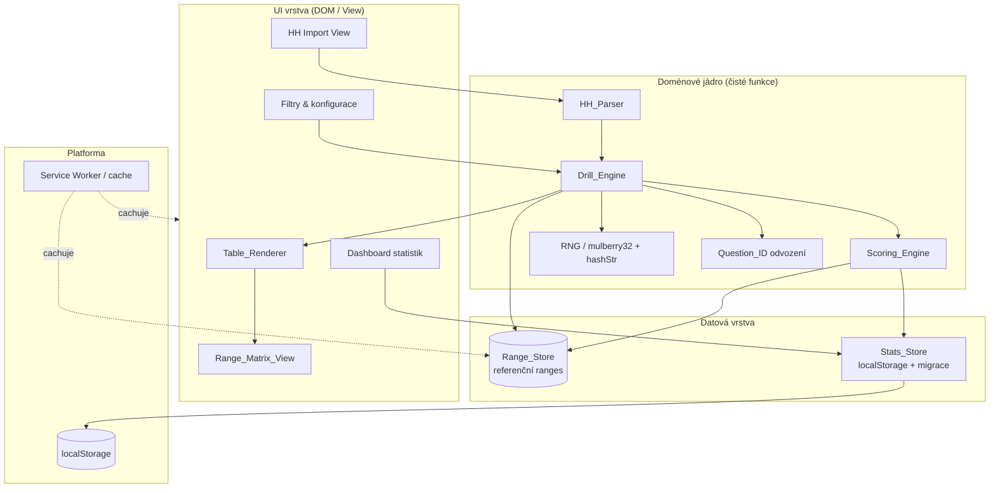
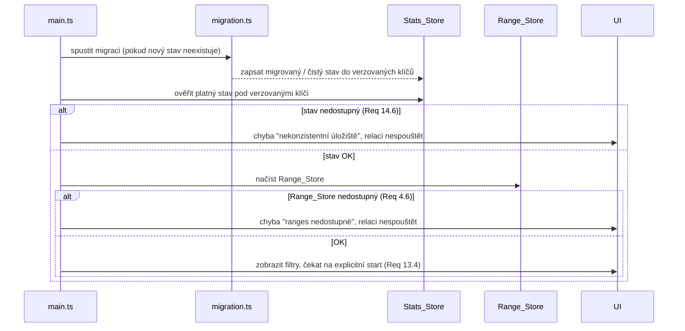
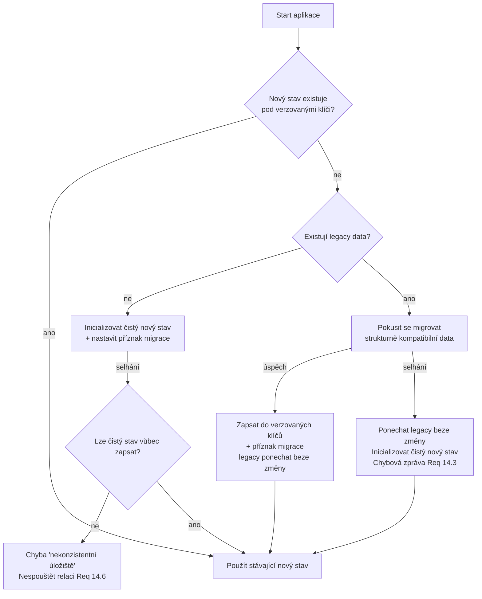

# Design Document — MTT Preflop Trainer

## Overview

MTT Preflop Trainer je nová, čistě klientská (offline-capable) aplikace pro trénink preflop rozhodování v turnajovém pokeru na **full ring 9-handed** stole napříč efektivními hloubkami **5–150 BB**. Aplikace generuje deterministické tréninkové spoty, nechá uživatele zvolit akci, vyhodnotí ji proti referenčním cEV ranges (režim LENIENT/STRICT), vizualizuje situaci v grafice připomínající pokerový klient, zobrazí doporučenou range v mřížce 13×13 a perzistuje statistiky.

Tato iterace je staví **nový build na Vanilla TypeScript + Vite**. Legacy soubor `Legacy/PKRTrainer.html` (6-max, 15–25 BB monolit) slouží jako **referenční baseline** ověřené logiky, nikoli jako kód k přímému znovupoužití. Z baseline přebíráme tyto ověřené koncepty (a portujeme je do typovaného, modulárního kódu):

- **Deterministický RNG** `mulberry32` + FNV-1a hash (`hashStr`) pro odvození seedů a Question_ID.
- **Pool unikátních spotů** na (kategorie × seed) — generování s deduplikací podle `id`.
- **Formát otázky**: `{ cat, ctx, id, prompt, answers, correctKeys, strictCorrect, hint, explanation }`.
- **Scoring LENIENT/STRICT**: `correctKeys` (přijatelné) vs `strictCorrect` (přesné, včetně sizingu).
- **Perzistence v localStorage** (stav + event log) a dashboard úspěšnosti po kategoriích.
- **Range matrix 13×13** (Flopzilla-style) s legendou.
- **HH parser** (PokerStars-like text) pro extrakci pole hrdiny.
- **Grafická simulace stolu** (`renderTableSim`) s sedadly, potem, odznaky akcí.

### Klíčové architektonické principy

1. **Data oddělená od logiky.** Referenční ranges (Range_Store) jsou statická, verzovaná data (TypeScript/JSON moduly), nikoli kód. Logika (Drill_Engine, Scoring_Engine) z nich pouze čte.
2. **Determinismus.** Stejný Seed + stejné filtry ⇒ bitově shodná sekvence spotů. Question_ID je čistá funkce parametrů spotu.
3. **Čisté jádro, tenké okraje.** Generování spotů, scoring, odvození Question_ID a migrace jsou čisté funkce (testovatelné property-based). I/O (DOM, localStorage) je izolováno na hranicích.
4. **Offline-first.** Veškerá data jsou součástí bundle; po prvním načtení žádné síťové požadavky. Service Worker zajistí cache pro Android WebView.
5. **Čeština v UI.** Veškerý uživatelský text (akce, chyby, zdůvodnění) je v češtině; strojové identifikátory (Akční_klíče) zůstávají v ASCII.

---

## Architecture

### Vrstvy



### Moduly (mapování na Glossary)

| Modul | Odpovědnost | Čistota |
|---|---|---|
| `Drill_Engine` | Generování spotů z (Seed, filtry); sestavení akčního stromu dle stavových stráží; tvorba Poolu a deduplikace; pořadí spotů; odvození Question_ID. | Čisté jádro |
| `Range_Store` | Statická referenční data (Pozice × Hloubkový_koš × akční kontext → Akční_klíče + sizing), varianty ante-on/ante-off; přístupové (lookup) funkce. | Data + čisté čtení |
| `Scoring_Engine` | Vyhodnocení odpovědi v LENIENT/STRICT proti datům z Range_Store; sestavení zdůvodnění. | Čisté jádro |
| `Table_Renderer` | Vykreslení 9-max stolu, sedadel, potu, stacků, odznaků akcí, karet hrdiny, BTN/SB/BB značek. | UI (I/O) |
| `Stats_Store` | Perzistence výsledků a stavu do localStorage; výpočet statistik; migrace z legacy klíčů. | Logika + I/O |
| `Range_Matrix_View` | Vykreslení mřížky 13×13 s barvením akcí, zvýrazněním ruky spotu, legendou. | UI (I/O) |
| `HH_Parser` | Parsování hand history textu na pole hrdiny; sestavení Spotu. | Čisté jádro |
| `RNG` | `mulberry32(seed)` + `hashStr` (FNV-1a) — deterministický generátor a hashovací primitiva. | Čisté jádro |

### Adresářová struktura (Vite + TypeScript)

```
/ (root)
├─ index.html
├─ vite.config.ts
├─ tsconfig.json
├─ package.json
├─ public/
│  └─ manifest.webmanifest
├─ src/
│  ├─ main.ts                      # bootstrap, error boundary, init pořadí (migrace → init → UI)
│  ├─ core/
│  │  ├─ rng.ts                    # mulberry32, hashStr (FNV-1a)
│  │  ├─ poker.ts                  # RANKS, R2V, pozice, kombinace rukou (169 tříd)
│  │  ├─ types.ts                  # Spot, ActionKey, StackBucket, ActionContext, ...
│  │  ├─ questionId.ts             # deterministické odvození Question_ID
│  │  ├─ actionTree.ts             # stavové stráže Požadavku 3 → nabídka akcí
│  │  ├─ drillEngine.ts            # generateSpot, buildPool, sekvence spotů
│  │  ├─ scoring.ts                # LENIENT/STRICT vyhodnocení
│  │  └─ hhParser.ts               # parser hand history
│  ├─ data/
│  │  ├─ ranges/                   # referenční ranges jako data (oddělená od logiky)
│  │  │  ├─ index.ts               # agregace + integrita (Req 4.6)
│  │  │  ├─ schema.ts              # typy/validace Range_Store
│  │  │  ├─ ante-on/               # varianta ante-on
│  │  │  └─ ante-off/              # varianta ante-off
│  │  └─ rangeStore.ts             # lookup API nad daty
│  ├─ persistence/
│  │  ├─ keys.ts                   # verzované klíče + legacy klíče
│  │  ├─ migration.ts              # migrace legacy → nové (idempotentní)
│  │  └─ statsStore.ts             # ukládání/čtení stavu, statistiky
│  ├─ ui/
│  │  ├─ tableRenderer.ts
│  │  ├─ rangeMatrixView.ts
│  │  ├─ filters.ts
│  │  ├─ dashboard.ts
│  │  └─ hhView.ts
│  └─ pwa/
│     └─ sw.ts                     # service worker (precache app shell + data)
└─ tests/
   ├─ properties/                  # property-based testy (fast-check)
   └─ unit/                        # příklady, edge cases, integrace
```

### Inicializační pořadí (kritické pro Req 14)



---

## Components and Interfaces

### RNG (`core/rng.ts`)

Portováno 1:1 z baseline pro zachování deterministické sekvence.

```ts
/** Deterministický PRNG. Stejný seed ⇒ stejná sekvence ∈ [0,1). */
export function mulberry32(seed: number): () => number;

/** FNV-1a 32-bit hash řetězce → uint32. */
export function hashStr(s: string): number;
```

### Question_ID (`core/questionId.ts`)

```ts
/** Stabilní ID spotu z jeho parametrů. Čistá funkce. */
export function questionId(p: {
  context: ActionContext;     // kategorie / akční kontext
  heroPos: Position;
  effStack: StackBucket;
  hand: HandLabel;            // např. "AKs", "T9o", "77"
  ante: AnteMode;             // "ON" | "OFF"
}): string;
// Formát: `${context}|${heroPos}|${effStack}|${hand}|${ante}`
```

### Action Tree (`core/actionTree.ts`)

Implementuje stavové stráže Požadavku 3 jako čistou funkci. Vrací množinu nabízených Akčních_klíčů pro daný stav stolu (bez ohledu na ranges — to řeší Range_Store).

```ts
export interface TableState {
  heroPos: Position;
  pushFold: boolean;          // eff <= 12 BB
  limpsBefore: number;        // 0..8
  callsBefore: number;        // 0..7
  facing: FacingAction;       // "NONE" | "OPEN" | "3BET" | "4BET" | "ALLIN"
  isBvB: boolean;
}

/** Vrátí nabízené kategorie akcí pro daný stav (stráže Req 3.1–3.13). */
export function offeredActions(state: TableState): ActionKind[];
```

### Drill_Engine (`core/drillEngine.ts`)

```ts
export interface Filters {
  positions: Position[];      // [] = neomezeno (Req 13.7)
  buckets: StackBucket[];     // [] = neomezeno
  contexts: ActionContext[];  // [] = neomezeno
  ante: AnteMode;
  scoringMode: "LENIENT" | "STRICT";
}

export interface SessionConfig {
  seed: number;               // 0..4294967295
  filters: Filters;
}

/** Vygeneruje deterministický Pool unikátních spotů pro (kategorie, seed, filtry). */
export function buildPool(seed: number, context: ActionContext, filters: Filters, store: RangeStore): Spot[];

/** Vygeneruje jeden spot z RNG a kontextu (interní, volané v buildPool). */
export function generateSpot(rng: () => number, context: ActionContext, filters: Filters, store: RangeStore): Spot | null;

/** Vrátí deterministickou sekvenci spotů napříč zvolenými kategoriemi. */
export function spotSequence(cfg: SessionConfig, store: RangeStore): Iterable<Spot>;
```

### Scoring_Engine (`core/scoring.ts`)

```ts
export interface Grade {
  correct: boolean;
  acceptable: ActionKey[];    // LENIENT sada
  strict: ActionKey[];        // STRICT sada
  recommended: ActionKey[];   // z Range_Store, k zobrazení
  explanationAvailable: boolean;
}

/** Vyhodnotí volbu. Čistá funkce nad daty Range_Store. */
export function grade(spot: Spot, chosen: ActionKey, mode: "LENIENT" | "STRICT"): Grade;
```

### Range_Store (`data/rangeStore.ts`)

```ts
export interface RangeEntry {
  /** Doporučené akce pro celou range (mapování ruka → akce). */
  actions: Record<HandLabel, ActionKey[]>;     // LENIENT množina
  strict: Record<HandLabel, ActionKey[]>;       // STRICT množina (vč. sizingu)
}

export interface RangeStore {
  /** Vrátí záznam pro kombinaci, nebo undefined (Req 4.8). */
  lookup(key: RangeKey): RangeEntry | undefined;
  /** True, pokud jsou data konzistentně načtena jako celek (Req 4.6). */
  isLoaded(): boolean;
}

export interface RangeKey {
  position: Position;
  bucket: StackBucket;
  context: ActionContext;
  ante: AnteMode;
}
```

### Stats_Store (`persistence/statsStore.ts`)

```ts
export interface ResultRecord {
  qid: string;
  chosen: ActionKey;
  correct: boolean;
  context: ActionContext;
  position: Position;
  bucket: StackBucket;
  ts: number;
}

export interface StatsStore {
  record(r: ResultRecord): SaveOutcome;          // Req 9.1, 9.6
  summary(): Summary;                            // Req 9.3
  breakdownBy(dim: "context" | "position" | "bucket"): Breakdown; // Req 9.4, 9.7
}
```

### Table_Renderer / Range_Matrix_View / HH_Parser

```ts
export function renderTable(spot: Spot, ante: AnteMode, root: HTMLElement): void;     // Req 8
export function renderMatrix(spot: Spot, store: RangeStore, root: HTMLElement): void; // Req 10
export function parseHandHistory(text: string): HHResult;                              // Req 11
```

---

## Data Models

### Základní typy (`core/types.ts`)

```ts
export type Position =
  | "UTG" | "UTG+1" | "UTG+2" | "LJ" | "HJ" | "CO" | "BTN" | "SB" | "BB";

/** Fixní pořadí preflop akce (Req 1.2). */
export const POSITION_ORDER: Position[] =
  ["UTG","UTG+1","UTG+2","LJ","HJ","CO","BTN","SB","BB"];

/** 13 diskrétních hloubkových košů (Req 2.1). */
export type StackBucket = 5|10|15|20|25|30|40|50|60|75|100|125|150;
export const STACK_BUCKETS: StackBucket[] =
  [5,10,15,20,25,30,40,50,60,75,100,125,150];

export const PUSH_FOLD_MAX = 12; // Req 2.3

export type AnteMode = "ON" | "OFF";

/** Akční kontext / kategorie (Req 13.3). */
export type ActionContext =
  | "RFI"            // RFI/Open
  | "VS_LIMP"        // Iso-raise vs limp(s)
  | "VS_OPEN"        // Fold/Call/3bet
  | "VS_3BET"        // Fold/Call/4bet
  | "VS_4BET"        // Fold/Call/Jam
  | "SQUEEZE"        // 3bet s callery v potu
  | "BVB"            // Blind-vs-blind
  | "PUSH_FOLD"      // <=12 BB: Jam/Fold
  | "VS_ALLIN";      // Call-jam/Fold

/** Strojové identifikátory akcí (Req 3.12, ASCII). */
export type ActionKey =
  | "FOLD" | "CALL" | "LIMP" | "OVERLIMP"
  | "OPEN_2X" | "OPEN_25X" | "OPEN_3X"
  | "ISO_2X" | "ISO_25X" | "ISO_3X"
  | "3BET" | "4BET" | "SQUEEZE"
  | "JAM" | "CALL_JAM";

/** Druh akce (bez sizingu) — výstup actionTree. */
export type ActionKind =
  | "FOLD" | "CALL" | "LIMP" | "OVERLIMP" | "OPEN"
  | "ISO" | "3BET" | "4BET" | "SQUEEZE" | "JAM" | "CALL_JAM";

export type HandLabel = string; // 169 tříd: "AA".."22","AKs","AKo",...

export interface Answer { key: ActionKey; label: string; } // label = český text

export interface Spot {
  id: string;                 // Question_ID
  context: ActionContext;
  heroPos: Position;
  effStack: StackBucket;
  ante: AnteMode;
  pushFold: boolean;
  hand: HandLabel;
  heroCards: [Card, Card];    // konkrétní karty pro vykreslení
  tableState: TableState;     // pro render + odvození nabídky akcí
  answers: Answer[];          // nabízené možnosti (1 ActionKey každá)
  correctKeys: ActionKey[];   // LENIENT (Req 7.3)
  strictCorrect: ActionKey[]; // STRICT (Req 7.2)
  explanation: string;        // české zdůvodnění
  hint?: string;
}

export interface Card { rank: Rank; suit: Suit; }
export type Rank = "A"|"K"|"Q"|"J"|"T"|"9"|"8"|"7"|"6"|"5"|"4"|"3"|"2";
export type Suit = "s"|"h"|"d"|"c";
```

### Range_Store schéma (`data/ranges/schema.ts`)

Data jsou indexovaná podle `Pozice × Hloubkový_koš × akční kontext`, s oddělenými variantami pro ante-on a ante-off.

```ts
export interface RangeFile {
  version: string;                  // verze dat (pro budoucí migrace dat)
  ante: AnteMode;
  entries: RangeRecord[];
}

export interface RangeRecord {
  position: Position;
  bucket: StackBucket;
  context: ActionContext;
  /** ruka → přijatelné Akční_klíče (LENIENT). Prázdné/chybějící = fold. */
  lenient: Record<HandLabel, ActionKey[]>;
  /** ruka → přesné Akční_klíče vč. sizingu (STRICT). */
  strict: Record<HandLabel, ActionKey[]>;
}
```

Pravidla integrity (vynucená `schema.ts` + `ranges/index.ts`):

- Každá `RangeRecord.strict[hand]` i `lenient[hand]` obsahuje ≥ 1 Akční_klíč, pokud je ruka přítomná (Req 7.6).
- Ruce bez záznamu jsou implicitně FOLD (Req 10.2).
- Pro raise akce musí existovat sizing-variantní klíč (např. `OPEN_2X`), Req 4.5; pokud sizing chybí, spot je povolen na základě dostupných klíčů (Req 4.7).
- Při nemožnosti načíst data jako celek `isLoaded()` vrátí `false` ⇒ Drill_Engine negeneruje (Req 4.6).

### Mapování akčního kontextu na stav stolu (Požadavek 3)

| Kontext | Stavová stráž (z Req 3) | Nabízené `ActionKind` |
|---|---|---|
| `RFI` | not pushFold, facing=NONE, žádný limp, hero≠BB | OPEN, (LIMP, OVERLIMP — viz níže), FOLD |
| `VS_LIMP` | not pushFold, facing=NONE, 1–8 limpů | ISO, OVERLIMP(*), FOLD; BB navíc LIMP(check) (3.3) |
| `VS_OPEN` | not pushFold, facing=OPEN | FOLD, CALL, 3BET |
| `SQUEEZE` | not pushFold, facing=OPEN, 1–7 callů | FOLD, CALL, 3BET, SQUEEZE |
| `VS_3BET` | not pushFold, facing=3BET | FOLD, CALL, 4BET |
| `VS_4BET` | not pushFold, facing=4BET | FOLD, CALL, JAM |
| `PUSH_FOLD` | pushFold, facing≠ALLIN | JAM, FOLD (výhradně, 3.9) |
| `VS_ALLIN` | facing=ALLIN (libovolný režim) | CALL_JAM, FOLD (výhradně, 3.10) |
| `BVB` | hero∈{SB,BB}, ostatní fold | dle kontextu výše (3.11) |

(*) Stráže pro `LIMP` (open-limp, 3.2) a `OVERLIMP` (3.13) platí jen mimo BB a mimo push/fold.

### Persistence — verzované klíče (`persistence/keys.ts`)

```ts
export const SCHEMA_VERSION = "v1";
export const NS = "mtt_preflop";

/** Nové verzované klíče (Req 14.1 — nesmí kolidovat s legacy). */
export const KEY_STATE   = `${NS}_state_${SCHEMA_VERSION}`;        // mtt_preflop_state_v1
export const KEY_EVENTS  = `${NS}_events_${SCHEMA_VERSION}`;       // mtt_preflop_events_v1
export const KEY_HH      = `${NS}_hh_${SCHEMA_VERSION}`;           // mtt_preflop_hh_v1
export const KEY_MIGRATED = `${NS}_migrated_${SCHEMA_VERSION}`;    // příznak dokončené migrace

/** Legacy klíče (read-only zdroj migrace). */
export const LEGACY_KEYS = {
  state:  "fuf_drill_v5_JungleStyle1",
  events: "fuf_drill_v5_JungleStyle1_events_v1",
  hh:     "fuf_hh_jungle_v1",
} as const;
```

### Migrace (`persistence/migration.ts`)



Migrace je **idempotentní**: po nastavení `KEY_MIGRATED` se při dalších spuštěních neopakuje (Req 14.2). Dokud není příznak nastaven, zápisy jdou výhradně do nových klíčů a legacy zůstávají nedotčené (Req 14.4).

---

## Correctness Properties

*Vlastnost (property) je charakteristika nebo chování, které musí platit napříč všemi platnými běhy systému — v podstatě formální tvrzení o tom, co má systém dělat. Vlastnosti tvoří most mezi lidsky čitelnou specifikací a strojově ověřitelnými zárukami správnosti.*

Tato sekce vychází z prework analýzy akceptačních kritérií. Po reflexi byly logicky redundantní vlastnosti sloučeny (např. inkluzivní stráže akčního stromu do jedné parametrizované vlastnosti, formátování potu a stacku do jedné vlastnosti, definice správnosti a její negace do jedné ekvivalence). Každá vlastnost níže nese unikátní validační hodnotu.

**Skupina: Struktura stolu**

### Property 1: Celistvost a unikátnost 9 pozic

*Pro libovolný* deterministicky vygenerovaný Spot obsadí stav stolu právě 9 sedadel, jejichž pozice tvoří přesně množinu {UTG, UTG+1, UTG+2, LJ, HJ, CO, BTN, SB, BB} bez opakování, a hrdina má přiřazenou právě jednu z těchto 9 pozic.

**Validates: Requirements 1.1, 1.3, 1.4**

**Skupina: Hloubky a režim push/fold**

### Property 2: Efektivní stack pouze z 13 košů

*Pro libovolný* vygenerovaný Spot je `effStack` celé číslo a prvek množiny {5, 10, 15, 20, 25, 30, 40, 50, 60, 75, 100, 125, 150} BB; nikdy nenabývá hodnoty mimo tuto sadu.

**Validates: Requirements 2.1, 2.2**

### Property 3: Krátký stack vynucuje push/fold

*Pro libovolný* vygenerovaný Spot, jehož `effStack` ≤ 12 BB a který nečelí all-inu, platí `pushFold = true` a nabídka akcí je přesně {JAM, FOLD}.

**Validates: Requirements 2.3, 3.9**

### Property 4: Hluboký stack nabízí sizingové raise akce

*Pro libovolný* vygenerovaný Spot, jehož `effStack` > 12 BB a jehož akční kontext zahrnuje raise akci, obsahuje nabídka akcí všechny raise-sizingové Akční_klíče, které Range_Store pro danou kombinaci Pozice × Hloubkový_koš × kontext definuje.

**Validates: Requirements 2.4**

**Skupina: Akční strom (Požadavek 3)**

### Property 5: Stavové stráže nabízejí očekávané akce

*Pro libovolný* `TableState` splňující stavovou stráž daného kontextu je odpovídající množina akcí podmnožinou nabídnutých akcí, dle této tabulky:
- not pushFold, facing=NONE, 0 limpů, hero≠BB ⇒ OPEN ∈ offered (3.1) a LIMP ∈ offered (3.2)
- not pushFold, facing=NONE, 1–8 limpů ⇒ ISO ∈ offered (3.4); hero≠BB ⇒ navíc OVERLIMP ∈ offered (3.13); hero=BB ⇒ {LIMP, ISO} ⊆ offered (3.3)
- not pushFold, facing=OPEN ⇒ {FOLD, CALL, 3BET} ⊆ offered (3.5)
- not pushFold, facing=OPEN, 1–7 callů ⇒ SQUEEZE ∈ offered (3.6)
- not pushFold, facing=3BET ⇒ {FOLD, CALL, 4BET} ⊆ offered (3.7)
- not pushFold, facing=4BET ⇒ {FOLD, CALL, JAM} ⊆ offered (3.8)

**Validates: Requirements 3.1, 3.2, 3.3, 3.4, 3.5, 3.6, 3.7, 3.8, 3.13**

### Property 6: Vs-all-in nabízí výhradně Call-jam a Fold

*Pro libovolný* `TableState`, který čelí all-inu (facing = ALLIN), je nabídka akcí přesně {CALL_JAM, FOLD}, nezávisle na tom, zda je Spot v režimu Push/Fold.

**Validates: Requirements 3.10**

### Property 7: Blind-vs-blind staví hrdinu mezi SB a BB

*Pro libovolný* Spot v kontextu BVB má hrdina pozici ∈ {SB, BB} a jeho nabídka akcí je konzistentní se stavovými strážemi (Property 5, 6 a Property 3) pro daný stav stolu.

**Validates: Requirements 3.11**

### Property 8: Každá nabízená akce má právě jeden Akční_klíč

*Pro libovolný* vygenerovaný Spot platí, že `answers` přiřazuje každé nabízené akci právě jeden Akční_klíč a všechny klíče v `answers` jsou navzájem různé (bijektivní mapování nabídka → klíč).

**Validates: Requirements 3.12**

**Skupina: Range_Store a doporučené akce**

### Property 9: Generovaný spot má neprázdné doporučení v obou sadách

*Pro libovolný* vygenerovaný Spot poskytuje Range_Store neprázdnou sadu přijatelných Akčních_klíčů (LENIENT) i neprázdnou sadu přesných Akčních_klíčů (STRICT), tj. `correctKeys.length ≥ 1` a `strictCorrect.length ≥ 1`, a vyhodnocení vždy nese ≥ 1 doporučený klíč k zobrazení.

**Validates: Requirements 4.4, 7.4, 7.6**

### Property 10: Scoring závisí výhradně na záznamu Range_Store pro daný spot

*Pro libovolný* Spot a libovolnou změnu záznamů Range_Store pro jiné kombinace (Pozice × Hloubkový_koš × kontext × ante) než je klíč daného Spotu zůstává výsledek vyhodnocení (`grade`) tohoto Spotu beze změny.

**Validates: Requirements 4.3**

### Property 11: Existence sizingu pro raise akce

*Pro libovolný* záznam Range_Store, který obsahuje raise Akční_klíč (RFI/Open, Iso-raise, 3bet, 4bet nebo Squeeze) jako přesnou (STRICT) doporučenou akci, nese tento klíč konkrétní sizing (např. `OPEN_2X`, `ISO_25X`).

**Validates: Requirements 4.5**

### Property 12: Generovatelnost spotu podle dostupnosti klíčů

*Pro libovolnou* kombinaci Pozice × Hloubkový_koš × kontext × ante platí: pokud Range_Store obsahuje ≥ 1 doporučený Akční_klíč (i bez kompletního sizingu), je Spot pro tuto kombinaci povolen a generován; pokud neobsahuje žádný klíč, Spot pro tuto kombinaci není generován.

**Validates: Requirements 4.7, 4.8**

**Skupina: Ante**

### Property 13: Ante mód určuje variantu dat i startovní pot

*Pro libovolný* Spot platí: je-li ante = ON, čerpá lookup z ante-on varianty Range_Store a startovní pot zahrnuje 1 BB ante (tj. SB 0,5 + BB 1 + ante 1 = 2,5 BB); je-li ante = OFF, čerpá z ante-off varianty a startovní pot tvoří pouze blindy (SB 0,5 + BB 1 = 1,5 BB).

**Validates: Requirements 5.2, 5.3**

**Skupina: Determinismus**

### Property 14: Stejný seed a filtry dávají identickou sekvenci spotů

*Pro libovolný* Seed a libovolné filtry platí, že dvě nezávislá generování produkují identickou sekvenci Spotů — stejný počet, stejné pořadí a pro každý Spot shodné Question_ID i shodné parametry (Pozice, Efektivní_stack, předchozí akce, karty hrdiny).

**Validates: Requirements 6.2**

### Property 15: Pool obsahuje pouze unikátní spoty v deterministickém pořadí

*Pro libovolný* Seed a kategorii neobsahuje vygenerovaný Pool dva Spoty se shodným Question_ID a opakované sestavení Poolu se stejnými parametry dává shodné pořadí.

**Validates: Requirements 6.3**

### Property 16: Question_ID je deterministická funkce parametrů

*Pro libovolné* dva spoty platí, že shodné parametry (kategorie, Pozice, Efektivní_stack, ruka hrdiny, ante) vedou na shodné Question_ID, a spoty lišící se v některém z těchto parametrů mají různé Question_ID.

**Validates: Requirements 6.4**

### Property 17: Jeden průchod Poolem nezobrazí Question_ID dvakrát

*Pro libovolný* Pool platí, že v rámci jednoho průchodu je každé Question_ID zobrazeno nejvýše jednou.

**Validates: Requirements 6.5**

### Property 18: Vyčerpaný Pool se cyklí od začátku ve stejném pořadí

*Pro libovolný* Pool platí, že po vyčerpání všech unikátních Spotů začíná nový průchod od prvního Spotu ve stejném deterministickém pořadí jako první průchod.

**Validates: Requirements 6.6**

**Skupina: Vyhodnocení (LENIENT / STRICT)**

### Property 19: STRICT správnost je členství v přesné sadě

*Pro libovolný* Spot a libovolný zvolený Akční_klíč platí: vyhodnocení ve STRICT režimu označí odpověď za správnou právě tehdy, je-li zvolený klíč prvkem `strictCorrect`; jinak za nesprávnou a zobrazí doporučené klíče.

**Validates: Requirements 7.2, 7.7**

### Property 20: LENIENT správnost je členství v přijatelné sadě

*Pro libovolný* Spot a libovolný zvolený Akční_klíč platí: vyhodnocení v LENIENT režimu označí odpověď za správnou právě tehdy, je-li zvolený klíč prvkem `correctKeys`; jinak za nesprávnou a zobrazí doporučené klíče.

**Validates: Requirements 7.3, 7.7**

**Skupina: Vykreslení (čisté výpočetní části)**

### Property 21: Formátování hodnot v BB na nejvýše jedno desetinné místo

*Pro libovolnou* velikost potu a libovolný efektivní stack platí, že jejich textová reprezentace v BB má nejvýše jedno desetinné místo a odpovídá aktuálnímu stavu ante.

**Validates: Requirements 8.5, 8.6**

### Property 22: Standardní rozložení mřížky 13×13

*Pro libovolnou* dvojici indexů (i, j) v mřížce 13×13 odpovídá pole správné třídě ruky: i = j ⇒ pár, i < j ⇒ suited, i > j ⇒ offsuit, a mřížka pokrývá přesně všech 169 tříd startovních rukou.

**Validates: Requirements 10.1, 10.4**

### Property 23: Barvení mřížky podle Akčního_klíče

*Pro libovolný* Spot s dostupnými daty přiřadí Range_Matrix_View každému ze 169 polí vizuální kategorii odpovídající doporučenému Akčnímu_klíči z Range_Store, přičemž ruce bez doporučené akce jsou zařazeny do kategorie fold odlišené od všech akčních kategorií.

**Validates: Requirements 10.2**

**Skupina: Perzistence a statistiky**

### Property 24: Záznam výsledku obsahuje povinná pole

*Pro libovolnou* zodpovězenou otázku uloží Stats_Store záznam obsahující Question_ID, zvolený Akční_klíč, příznak správnosti, kategorii akce, Pozici a Hloubkový_koš daného Spotu.

**Validates: Requirements 9.1**

### Property 25: Perzistence je round-trip

*Pro libovolný* platný stav statistik platí, že jeho uložení a následné načtení vrátí ekvivalentní stav (serializace/deserializace je identita).

**Validates: Requirements 9.2**

### Property 26: Konzistentní agregace statistik

*Pro libovolnou* sadu záznamů výsledků platí, že úspěšnost = (počet správných / celkový počet) × 100 zaokrouhleno na jedno desetinné místo, a součet počtů zodpovězených Spotů přes všechny skupiny dané dimenze (kategorie / Pozice / Hloubkový_koš) se rovná celkovému počtu zodpovězených Spotů.

**Validates: Requirements 9.3, 9.4**

### Property 27: Stav série (streak) sleduje sekvenci odpovědí

*Pro libovolnou* sekvenci odpovědí platí, že po každé správné odpovědi se streak zvýší o 1 oproti předchozí hodnotě a po každé nesprávné odpovědi je streak roven 0.

**Validates: Requirements 9.5**

**Skupina: HH parser**

### Property 28: HH round-trip zachová pole hrdiny a sestaví Spot

*Pro libovolný* validní Spot platí, že jeho vytištění do podporovaného HH formátu a následné naparsování vytěží ekvivalentní pole hrdiny (Pozice, akce, hloubky v BB, karty) a — odpovídá-li model 9-handed stolu a koš 5–150 BB — sestaví zobrazitelný Spot.

**Validates: Requirements 11.1, 11.4**

### Property 29: Parser je totální a označuje nečitelná pole

*Pro libovolný* vstupní řetězec (včetně prázdného, bílých znaků, nevalidního a neúplného) dokončí HH_Parser zpracování bez pádu, vrátí výsledek (případně částečný) a označí, která z polí (pozice, akce, hloubky, karty) se nepodařilo vytěžit.

**Validates: Requirements 11.2, 11.3**

### Property 30: Nekompatibilní data nesestaví Spot

*Pro libovolná* naparsovaná data, která neodpovídají modelu 9-handed stolu nebo jejichž Efektivní_stack leží mimo rozsah košů 5–150 BB, platí, že HH_Parser nesestaví Spot, vrátí indikaci nekompatibility a neprovede pád.

**Validates: Requirements 11.5**

**Skupina: Filtrování**

### Property 31: Filtrování je logický průnik dimenzí

*Pro libovolnou* kombinaci filtrů (Pozice, Hloubkové_koše, akční kontexty) splňuje každý vygenerovaný Spot logický průnik všech dimenzí, přičemž dimenze bez zvolené hodnoty je považována za neomezenou (zahrnuje všechny své hodnoty).

**Validates: Requirements 13.5, 13.7, 13.8**

**Skupina: Migrace lokálního úložiště**

### Property 32: Nové klíče jsou verzované a nekolidují s legacy

*Pro každý* nový klíč lokálního úložiště platí, že obsahuje explicitní identifikátor verze a není shodný s žádným z legacy klíčů (`fuf_drill_v5_JungleStyle1`, `fuf_drill_v5_JungleStyle1_events_v1`, `fuf_hh_jungle_v1`).

**Validates: Requirements 14.1**

### Property 33: Migrace přenáší kompatibilní data, nechává legacy nedotčené a je idempotentní

*Pro libovolný* výchozí obsah lokálního úložiště platí: migrace přenese do nových verzovaných klíčů ta legacy data, jejichž struktura odpovídá novému formátu, ponechá legacy klíče beze změny až do zaznamenání příznaku dokončené migrace, a opakované provedení migrace již nezmění výsledný nový stav (migrate(migrate(s)) = migrate(s)).

**Validates: Requirements 14.2, 14.4**

---

## Error Handling

Aplikace musí být odolná: žádná z níže uvedených chyb nesmí způsobit pád (uncaught výjimka rozbíjející UI). Globální error boundary v `main.ts` (po vzoru `window.addEventListener("error", ...)` z baseline) zachytí neočekávané chyby a zobrazí české upozornění.

| Situace | Požadavek | Chování |
|---|---|---|
| Range_Store nelze načíst jako celek | 4.6 | `isLoaded()=false` ⇒ Drill_Engine negeneruje žádné spoty, relace se nespustí, zobrazí se české upozornění „Referenční ranges nejsou dostupné.“ Bez pádu. |
| Kombinace bez doporučeného klíče | 4.8 | Spot pro tuto kombinaci se negeneruje (tiše vynechán z Poolu). |
| Kombinace s klíčem ale bez sizingu | 4.7 | Spot povolen na základě dostupných klíčů. |
| Selhání zobrazení zdůvodnění | 7.5 | Vyhodnocení se dokončí, výsledek se uloží, zobrazí se indikace „Zdůvodnění není dostupné“. Bez pádu. |
| Selhání uložení výsledku | 9.6 | Dříve uložená data zůstanou beze změny, vyhodnocení se dokončí, zobrazí se „Výsledek se nepodařilo uložit“. |
| Prázdná skupina ve statistikách | 9.7 | Počet = 0 a indikace nedostupné úspěšnosti (místo procenta), žádné dělení nulou. |
| Range_Matrix_View bez dat | 10.6 | Zobrazí indikaci nedostupnosti dat, bez pádu. |
| HH: prázdný / nevalidní / neúplný vstup | 11.2, 11.3 | Vrátí (částečný) výsledek, označí nečitelná pole, zobrazí chybu, bez pádu. |
| HH: data mimo model trenažéru | 11.5 | Spot se nesestaví, zobrazí se chyba o nekompatibilitě, bez pádu. |
| HH: vstup > 100 000 znaků | 11.6 | Zpracování odmítnuto, chyba o překročení délky, bez pádu. |
| Selhání cache při prvním načtení | 12.4 | Upozornění „Aplikaci nelze používat offline“, bez pádu. |
| Prázdný průnik filtrů | 13.6 | Žádný spot, výběr filtrů zachován, upozornění s výzvou k úpravě filtrů. |
| Selhání migrace | 14.3 | Legacy beze změny, inicializace čistého nového stavu, chyba „migrace neproběhla, statistiky jsou prázdné“. |
| Migrace OK, init selže | 14.5 | Pokračovat s migrovanými daty. |
| Nelze migrovat ani inicializovat | 14.6 | Chyba „nekonzistentní stav lokálního úložiště“, relace se nespustí, dokud neexistuje platný stav. |

### Principy

- **Fail-safe defaults:** při nejistotě raději relaci nespustit (Req 4.6, 14.6) než generovat nevalidní spoty.
- **Izolace I/O:** veškeré `localStorage` a DOM operace jsou obalené try/catch; čisté jádro nikdy nehází kvůli I/O.
- **Lokalizované zprávy:** všechny chybové texty jsou v češtině (Req 12.3).
- **Defenzivní serializace:** načítání stavu sloučí výchozí strukturu s uloženými daty (`{ ...freshState(), ...obj }`) pro odolnost proti chybějícím polím (vzor z baseline).

---

## Testing Strategy

### Posouzení vhodnosti PBT

Funkce obsahuje rozsáhlé **čisté jádro** (deterministické generování spotů, akční strom, odvození Question_ID, scoring, agregace statistik, parser, migrace) s univerzálními vlastnostmi nad velkým vstupním prostorem (seedy, filtry, stavy stolu, ruce, řetězce HH). **PBT je proto vysoce vhodné** a tvoří páteř testování jádra. UI vykreslování (DOM struktura stolu, vizuál matice, odznaky) a infrastruktura (Service Worker, WebView) se testují jinými prostředky.

### Dvojí přístup

**Property-based testy** (jádro, univerzální vlastnosti):
- Knihovna: **fast-check** (standard pro TypeScript/Vitest); PBT neimplementujeme od nuly.
- Minimálně **100 iterací** na každý property test (`fc.assert(..., { numRuns: 100 })`, kde vhodné víc).
- Každý test je označen komentářem odkazujícím na vlastnost z tohoto dokumentu.
- Formát značky: `// Feature: mtt-preflop-trainer, Property {číslo}: {text vlastnosti}`
- Každá z vlastností 1–33 je implementována **jediným** property testem.
- Generátory pokrývají edge cases z prework: seed na hranicích 0 a 4 294 967 295 (Req 6.1), prázdné/whitespace/nevalidní HH vstupy (Req 11.2), vstupy > 100 000 znaků (Req 11.6), prázdné dimenze filtrů (Req 13.7), neexistující skupiny statistik (Req 9.7).

**Příklad-based unit testy** (specifické chování, edge cases, chybové toky):
- Fixní pořadí pozic (Req 1.2), výchozí ante-on 1 BB (Req 5.1), bez seedu se vygeneruje platný seed (Req 6.7), podpora obou režimů (Req 7.1).
- Chybové toky: Range_Store nedostupný (4.6), selhání zdůvodnění (7.5), selhání uložení (9.6), matice bez dat (10.6), HH > 100k (11.6), prázdný průnik filtrů (13.6), selhání/varianty migrace (14.3, 14.5, 14.6), bez startu se negeneruje (13.4).
- UI rendering (DOM): 9 sedadel s unikátními labely (8.1), právě 1 hero sedadlo (8.2), 2 hole karty (8.3), akční odznak (8.4), značky BTN/SB/BB (8.7), složená sedadla (8.8), zvýraznění ruky v matici (10.3), legenda (10.5) — ověřeno přes jsdom/Testing Library na výstupní DOM struktuře.

**Snapshot / integrační testy** (infrastruktura — NENÍ PBT):
- Offline provoz a Service Worker precache (Req 12.1, 12.5): integrační test, že po nakešování fungují generování/scoring/statistiky/matice bez síťových požadavků (1–3 scénáře).
- Android WebView kompatibilita (Req 12.2): manuální/zařízení nebo emulátor, smoke ověření.
- Selhání cache (Req 12.4): integrační simulace selhané registrace SW.

**Statické kontroly (SMOKE):**
- Data oddělená od logiky (Req 4.1): lint pravidlo / kontrola, že moduly v `data/ranges/**` neimportují `core/**` logiku.
- cEV bez ICM (Req 4.9): metadata varianty + revize obsahu dat.
- Definice pozic v glossary (Req 1.5) a čeština UI (Req 12.3): revize.

### Pokrytí požadavků vlastnostmi

| Vlastnost | Požadavky |
|---|---|
| 1 | 1.1, 1.3, 1.4 |
| 2 | 2.1, 2.2 |
| 3 | 2.3, 3.9 |
| 4 | 2.4 |
| 5 | 3.1–3.8, 3.13 |
| 6 | 3.10 |
| 7 | 3.11 |
| 8 | 3.12 |
| 9 | 4.4, 7.4, 7.6 |
| 10 | 4.3 |
| 11 | 4.5 |
| 12 | 4.7, 4.8 |
| 13 | 5.2, 5.3 |
| 14 | 6.2 |
| 15 | 6.3 |
| 16 | 6.4 |
| 17 | 6.5 |
| 18 | 6.6 |
| 19 | 7.2, 7.7 |
| 20 | 7.3, 7.7 |
| 21 | 8.5, 8.6 |
| 22 | 10.1, 10.4 |
| 23 | 10.2 |
| 24 | 9.1 |
| 25 | 9.2 |
| 26 | 9.3, 9.4 |
| 27 | 9.5 |
| 28 | 11.1, 11.4 |
| 29 | 11.2, 11.3 |
| 30 | 11.5 |
| 31 | 13.5, 13.7, 13.8 |
| 32 | 14.1 |
| 33 | 14.2, 14.4 |

Požadavky pokryté primárně příklad/integrace/smoke testy (mimo property sadu): 1.2, 1.5, 2.5, 2.6, 4.1, 4.2, 4.6, 4.9, 5.1, 5.4, 6.1, 6.7, 7.1, 7.5, 8.1–8.4, 8.7, 8.8, 9.6, 9.7, 10.3, 10.5, 10.6, 11.6, 12.1–12.5, 13.1–13.4, 13.6, 14.3, 14.5, 14.6.

### Testovací nástroje

- **Test runner:** Vitest (nativní pro Vite).
- **PBT:** fast-check.
- **DOM testy:** jsdom + @testing-library/dom.
- **Pokrytí:** minimálně jádro (`core/**`, `persistence/**`, `data/**`) s vysokým pokrytím; UI a PWA dle možností integračně.
